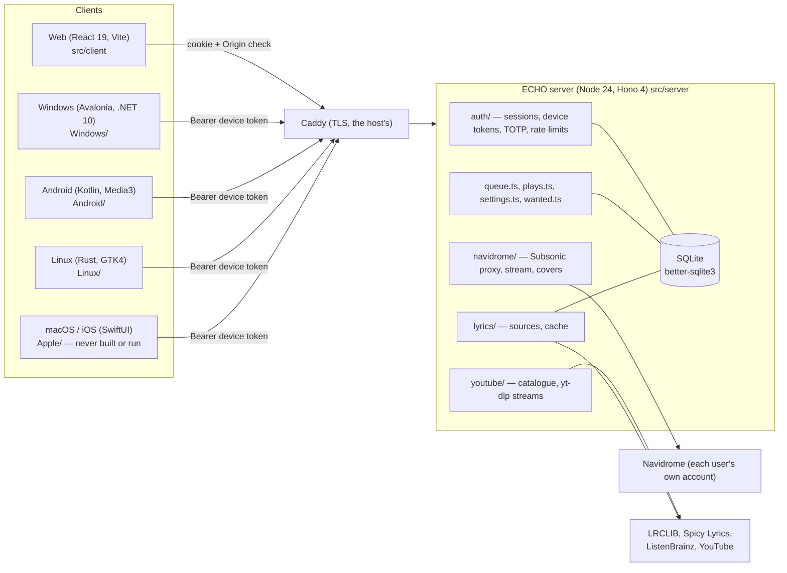
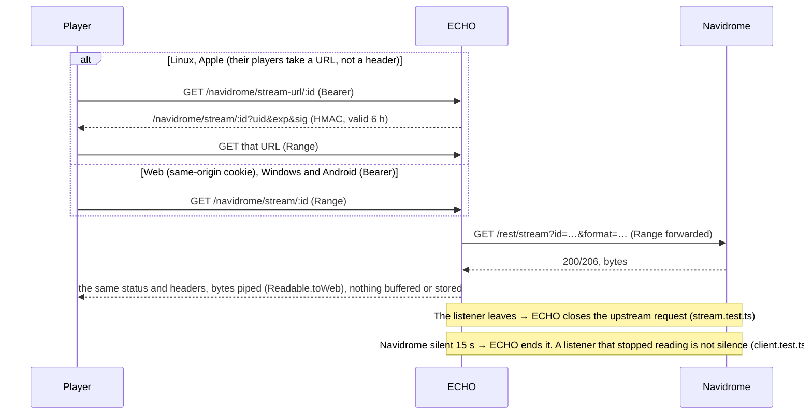

# Architecture

Verified by reading the code at the paths given, unless a sentence says otherwise.

## 1. The parts



- One process, one SQLite file. No queue, no cache server, no second service.
- The server keeps no audio. A song is piped from Navidrome (or from YouTube through yt-dlp's
  resolved URL) to the listener.
- Each user connects their own Navidrome account; its credentials are sealed in the database
  (`src/server/crypto.ts`, AES-256-GCM under a key from a file).

## 2. Where the code is

| Path | What |
|---|---|
| `src/server/index.ts` | `createApp(deps)`: every route is mounted here |
| `src/server/http.ts` | Host check, Origin check, response headers, 64 KB body limit |
| `src/server/auth/` | Passwords (argon2id), sessions (hashed tokens), TOTP, login limits, the API budget |
| `src/server/navidrome/url.ts` | Which Navidrome URL a user may connect (the SSRF rules), address pinning |
| `src/server/navidrome/client.ts` | One user's Subsonic client: signing, timeouts |
| `src/server/navidrome/routes.ts` | The allow-listed proxy, `/stream/:id`, `/stream-url/:id`, `/cover/:id` |
| `src/server/navidrome/mock.ts` | A Subsonic server for tests, with faults (`down`, `slowMs`, `breakStreamAt`, …) |
| `src/server/youtube/` | Catalogue (youtubei.js), `ytdlp.ts` (URL cache, two at a time, prefetch) |
| `src/server/queue.ts` | The saved queue: `GET`, `PUT`, `PATCH`, compare-and-set on `updated_at` |
| `src/client/api.ts` | The web's one way to call the server |
| `src/client/connection.ts` | Whether the server can be reached; the probe loop |
| `src/client/playback/` | Queue, controller, the Navidrome provider (two `<audio>` voices), queue sync |
| `src/client/shell/fresh.ts` | `useFresh`: page data with a cache and protection against late answers |
| `Windows/App/Api/Api.cs` | The Windows client's API |
| `Windows/App/Playback/` | `Player.cs`, `ProgressiveStream.cs` (download while playing), miniaudio output |
| `docs/api/openapi.yaml` | The API; `src/server/openapi.test.ts` fails when a route is missing from it |

## 3. A JSON request

```mermaid
sequenceDiagram
  participant C as Client
  participant E as ECHO
  participant N as Navidrome
  C->>E: GET /api/v1/navidrome/rest/getAlbum?id=…
  Note over E: http.ts: Host, Origin (cookie + unsafe method only)
  Note over E: auth: session or device token → user; API budget (50 burst, 10/s)
  Note over E: method on the allow-list? stored credentials unsealed
  E->>N: GET /rest/getAlbum?id=…&u=…&t=md5(pw+salt)&s=salt (kept-alive connection)
  N-->>E: subsonic-response
  Note over E: parsed, status checked (rejected credentials → code navidrome.auth)
  E-->>C: JSON
```

## 4. A song



## 5. Judgement

- **Strengths (verified):** one small server with clear seams; every dependency of a route is passed
  in (`deps`), so tests run the real app against a mock Subsonic server; a contract test ties the
  routes to the OpenAPI file; an isolation test (`src/server/isolation.test.ts`) fails when a new
  route is not shown to keep one user's data from another. It caught this audit's new route.
- **Debt:** five clients each reimplement the API client, the queue and the queue save. What one
  learns (trimming the queue to 64 KB, the position-only save, retries) reaches the others only by
  hand. The table in [ECHO-COMMUNICATION.md](ECHO-COMMUNICATION.md) §6 shows where each stands.
  A shared library is not proposed: four languages, and each client is small.
- **Not a problem, though it looks like one:** the proxy rebuilds its Subsonic client on every
  request. Measured: it costs microseconds ([PERFORMANCE.md](PERFORMANCE.md) §3).
