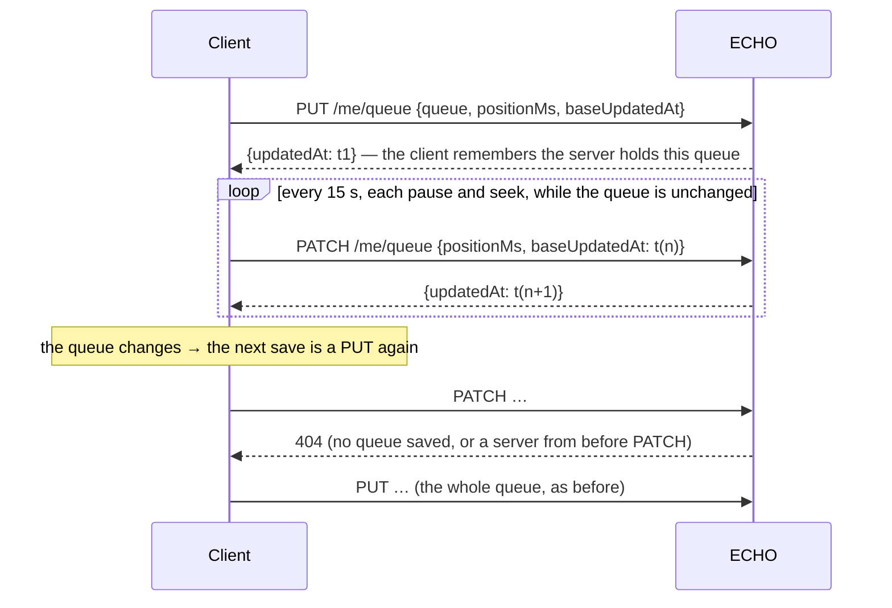

# Client ↔ ECHO communication

Status: web COMPLETED · Windows COMPLETED · queue save COMPLETED · Linux COMPLETED · Android
TESTING (not run on a device) · Apple BLOCKED (never built).

## 1. What was there (verified by reading, before any change)

| Concern | Web (`src/client/api.ts`) | Windows (`Api.cs`) |
|---|---|---|
| Timeout | none: a hung request waited for ever | 30 s (`HttpClient.Timeout`) |
| Retry | none | none |
| 401 | handled centrally: the session is ended, the sign-in page shows | `ApiException.SignedOut` → `Player.Refused()` |
| Server unreachable | `reportDown()` → `connection.ts` probes with backoff 1…30 s | a notice, "Can't reach the server." |
| Late answers | `useFresh` drops them (`live` flag, `src/client/shell/fresh.ts`) | not reviewed in depth |
| API budget (429) | shown as an error | shown as an error |

The server gives each user 50 requests at once and 10 a second after that
(`src/server/auth/ratelimit.ts`), answering 429 with `retry-after: 1`.

## 2. Web: `api()` now has a timeout and bounded retries

`src/client/api.ts`, tests in `src/client/api.test.ts`.

- **Timeout:** 45 s per attempt (`AbortSignal.timeout`). Longer than the server's own 30 s deadline
  for a Navidrome reply, so the server's answer wins when there is one.
- **Retries:** GET only, twice at most. Waits `300 ms × 3^attempt × (0.5…1.5)`: about 0.15–0.45 s,
  then 0.45–1.35 s. The jitter is there so that several tabs or devices that lost the server
  together do not all return in the same instant.
- **What is retried:** a failed fetch (no connection); 502, 503, 504 *without an ECHO error body*
  (a reverse proxy's answer while the server restarts); 429, after the `retry-after` the server gave.
- **What is not:** any write (POST, PUT, PATCH, DELETE: it may have been applied); a timeout (it
  already took 45 s); ECHO's own 502 with a code such as Navidrome being down (that is an answer,
  and asking again within a second will not change it); 401 and every other 4xx.
- `reportDown()` is still called on the first failure, so the "can't reach the server" state shows
  as early as before.

**Why not an AbortController per page?** `useFresh` already ignores an answer that arrives after
the page changed. Aborting would save the download of a small JSON body and add state to every
caller. Not done.

## 3. Web: the probe loop

`src/client/connection.ts`. Two changes:

- Each probe has a 10 s timeout. Before, one probe that never answered stopped the loop for good:
  the app would stay "offline" until reloaded. (Verified by reading: the next probe was only
  scheduled when the last one settled.)
- The backoff is jittered (×1…1.25).

## 4. The queue save: the position alone

Before: every save sent the whole queue, up to 60 KB, every 15 s while a song plays, and on every
pause and seek (`src/client/playback/queueSync.ts`, `Windows/App/Playback/Player.cs`).

Now `PATCH /api/v1/me/queue` (and `/me/queue/youtube`) takes `{ positionMs, baseUpdatedAt }`
(`src/server/queue.ts`):

| Case | Answer |
|---|---|
| body not `{ positionMs ≥ 0, baseUpdatedAt }` | 400 `bad_queue` |
| the user has no saved queue | 404 `no_queue` |
| the queue was saved by another device since `baseUpdatedAt` | 409 `changed_elsewhere`, as `PUT` |
| otherwise | the position is set (`json_set`), `updatedAt` is bumped and returned |

- Web: `held` is the slot whose queue the server holds; any queue change clears it.
- Windows: `savedQueue` is the JSON last saved whole; a save compares and sends `PATCH` when equal.
- Both fall back to `PUT` on a 4xx other than 409, so a client newer than its server still saves.
  (On the web a 401 also falls through to the `PUT`, whose 401 ends the session as before; Windows
  treats the 401 at once.)
- The compare-and-set is the same as `PUT`'s: a `PATCH` cannot move the position of a queue another
  device replaced. `src/server/isolation.test.ts` shows one user's `PATCH` cannot touch another's.

No byte count is claimed beyond the arithmetic: a `PATCH` body is two numbers; a `PUT` body is the
queue, capped at 60 KB by the clients and 64 KB by the server.

## 5. Windows: `Api.Send`

`Windows/App/Api/Api.cs`, test `AReadThatFailedOnTheWayIsAskedAgainAndAWriteIsNot`. The same policy
as the web: GET only, twice at most, the same delays (`RetryDelay`), on `HttpRequestException`, a
bodiless 502–504, and 429 with its `Retry-After`. A timeout (`TaskCanceledException`) is not
retried.

## 6. Android and Linux

**Android** (`Android/app/src/main/kotlin/com/folk3s/echo/`), built and unit-tested, **not run on a
device**:

- `playback/Playback.kt` `fitted()`: the saved queue is cut to 60 KB as `trimQueue` and `Fitted`
  cut it. Before, `save()` sent everything, the server refused a body over 64 KB, and `save()`
  dropped every error but 409: a long queue was silently never saved. `QueueTest` shows a
  3,000-song queue is over the server's limit and that the cut one fits.
- `save()`: `PATCH` when the queue is the one last saved whole (`savedQueue`), else `PUT`; a
  refused `PATCH` (4xx other than 401 and 409) falls back to `PUT`.
- `api/Api.kt` `call()`: the same retry policy for GET. A timeout is not retried.

**Linux** (`Linux/src/api.rs`), built and tested (`cargo test`, a local socket that answers 502
twice): a 30 s timeout on every request (there was none: a hung request held its worker thread for
ever), and the same retry policy in `get()`.

## 6a. Where each client stands now

| | Web | Windows | Android | Linux | Apple |
|---|---|---|---|---|---|
| Request timeout | 45 s | 30 s | OkHttp defaults (10 s each phase) | 30 s | not checked |
| Bounded retry of reads | yes | yes | yes | yes | no |
| Position-only save | yes | yes | yes | n/a (no queue save) | n/a |
| Queue trimmed to 64 KB | yes | yes | yes | n/a | n/a |
| Exercised by | unit + E2E | unit (headless) | unit only | unit | nothing |

## 7. UI

The brief allowed UI changes where needed. None was: a retry that succeeds should be invisible,
and one that fails ends in the states the app already has (the offline notice and probe loop on
the web, the notice line on Windows). A "retrying…" indicator for a wait of at most 1.8 s would be
noise. No diagnostics page was added: nothing asked for one.

## 8. Not centralised

Requests on the web already go through one function (`api()`), and on Windows through one
(`Api.Send`). That is the centralisation that solves a real problem; no further layer was added.
